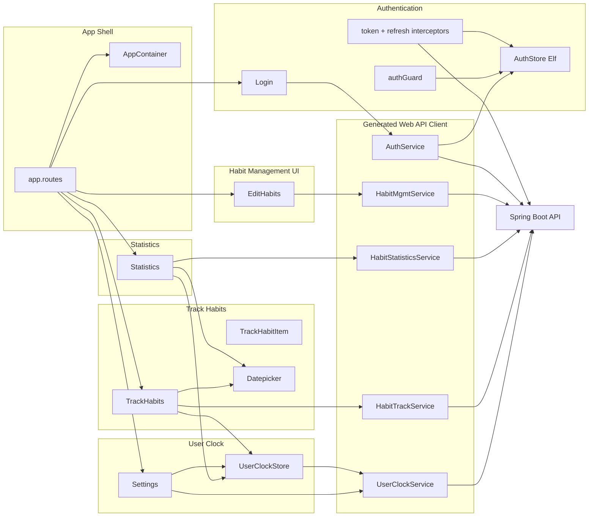
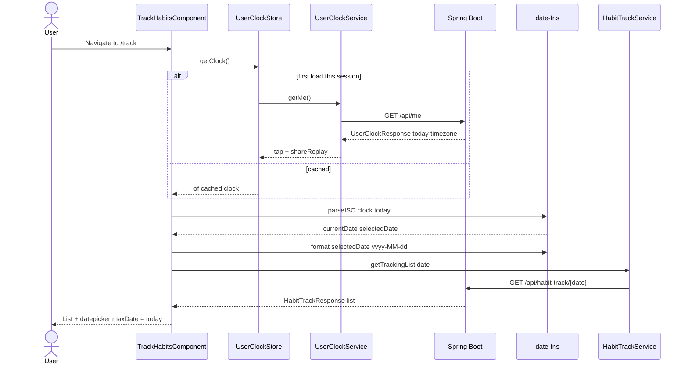
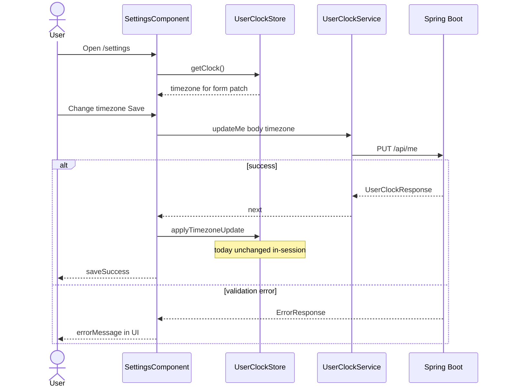

# Architecture — habit-tracker-angular

Synthesis of the full-repo developer scan (commit `e4cfc226`). Component catalogue: [component-inventory.md](./component-inventory.md). Consumed HTTP surface: [api-documentation.md](./api-documentation.md).

## Architecture Analysis

### System Overview

A single-page **Angular 18 standalone SPA** (`habit-tracker-ui`) in front of a sibling **Spring Boot** API (system of record). The browser hosts routing, forms, Elf-backed JWT persistence, and an in-memory **User Clock** cache. All habit and profile data crosses HTTP through **ng-openapi-gen** adapters under `src/app/web-api/`. Domain law (check-in window, streak, pause/archive) is not re-implemented in the UI; AGENTS.md and README defer to `habit-tracker-springboot/docs/domain.md`.

**Server-authoritative today**: Track and Statistics seed dates from `UserClockStore.getClock()` → `GET /api/me` (`today` as ISO `yyyy-MM-dd`, `timezone` as IANA). Settings updates timezone via `PUT /api/me` and applies `UserClockStore.applyTimezoneUpdate()` (FR3.3: in-session `today` is preserved; only timezone is replaced).

### Architectural Style

**Layered SPA (modular monolith frontend)** — one npm package, one deployable static bundle (nginx in Docker), standalone components (`ht` prefix), functional HTTP interceptors, route guards.

Evidence: `bootstrapApplication` + `provideRouter` + `provideHttpClient(withInterceptors(...))` in `app.config.ts`; no internal libraries; `environment.apiUrl` empty string with same-origin `/api` (dev proxy or production nginx → backend).

Context mapping to the backend is **Conformist / Published Language**: DTOs and paths come from checked-in OpenAPI. The **User Clock** component is a thin **ACL** for session-scoped caching of `/api/me`, not a second calendar authority.

### Component Relationships

### Data Flow

1. **Login** (`/login`, `noAuthGuard`): `AuthService.login` → JWT + username stored in Elf persist (`ht_auth` / `localStorage`). Interceptors attach `Authorization` on subsequent calls.
2. **Authenticated shell** (`AppContainerComponent`, `authGuard` on children): default redirect `/` → `track`. Nav: Track, Edit, Statistics, Settings, Logout.
3. **User clock bootstrap**: First consumer of `UserClockStore.getClock()` triggers single shared `GET /api/me` (`shareReplay(1)`). Track and Statistics parse `clock.today` with `date-fns` `parseISO` for `currentDate` / range defaults.
4. **Track**: `GET /api/habit-track/{date}` for list; check-in/unmark `POST`/`DELETE /api/habit-track` with `{ date, habitId }` formatted from **selected** date (still civil `yyyy-MM-dd` strings). Datepicker `maxDate` bound to server `today`; **no `minDate`** on track screen — UI may allow dates outside backend check-in window.
5. **Statistics**: `startDate = startOfMonth(today)`, `endDate = today` from clock; `GET /api/statistics/{startDate}/{endDate}`.
6. **Settings**: Form prefilled from clock; `PUT /api/me` `{ timezone }`; success calls `applyTimezoneUpdate`; **HttpErrorResponse** surfaced in template (first real API error UX in app).
7. **Logout / 401**: `refresh-token.interceptor` clears auth and navigates to login (TODO: no refresh-token rotation).

### Key Design Decisions

| Decision | Context | Alternatives considered | Consequences |
|----------|---------|-------------------------|--------------|
| Generated OpenAPI client | `swagger/api-docs.json` + `ng-openapi-gen` | Hand-written HttpClient | Regenerate after backend contract changes; do not edit `web-api/` |
| Elf persist for auth only | JWT session across refresh | Include timezone in localStorage | Clock is memory-only; cleared on full reload until next `GET /api/me` |
| In-memory User Clock cache | Avoid duplicate `/api/me` on every screen | Per-route fetch; persist clock | Must `clear()` on logout; timezone update does not refetch `today` (by design) |
| Server today for defaults/max | Align UI with backend civil day | Browser `new Date()` | Track/statistics agree with API boundaries when clock load succeeds |
| Domain enforcement in backend | README / AGENTS.md | Client-side check-in rules | UI should hide illegal actions; gaps (no track `minDate`) defer failures to API |
| Functional interceptors | Angular 18 `withInterceptors` | Class-based interceptors | Token + 401 logout pipeline is centralized |

### Improvement Opportunities

- **Refresh token** flow instead of logout-on-401 (`refresh-token.interceptor.ts` TODO).
- **Track datepicker `minDate`** aligned with backend “yesterday window” (or hide out-of-window dates) — currently domain-deferred.
- **Login error UX** (success-only subscribe) and **Track check-in errors** — reuse Settings `ErrorResponse` pattern.
- **Datepicker re-init** when `maxDate`/`today` changes after `ngAfterViewInit` (still one-shot options).
- **OpenAPI / UI parity**: `HabitDto` may omit pause/archive/state visible in backend domain doc — confirm contract drift.
- **AuthProps typing**: nullable fields vs strict `string` interface in `auth.store.ts`.

## Interaction Diagrams

### Session bootstrap and server today (Track)

### Timezone save (Settings)

<!--
Text fallback — Track with server today:
1. User opens Track; ngOnInit calls UserClockStore.getClock().
2. Store issues GET /api/me once per session (shareReplay), caches UserClockResponse.
3. Track parses clock.today to Date, sets selectedDate and currentDate, calls refresh().
4. refresh formats selectedDate to yyyy-MM-dd and GET /api/habit-track/{date}.
5. Check-in/unmark POST or DELETE /api/habit-track with same formatted date; subscribe success-only.
6. Datepicker maxDate is server today; minDate not set on track template.

Text fallback — Settings timezone:
1. Form patched from getClock().timezone.
2. PUT /api/me with selected IANA timezone.
3. On success applyTimezoneUpdate keeps prior today, updates timezone only.
4. On HTTP error, message shown from err.error.message.
-->

## Impact for Intent 260914-full-repo-scan

Full-repo scan documents **as-built** UI architecture including **user-clock** integration (relevant to timezone/today theme across the monorepo). Remaining gaps (refresh token, track minDate, login errors, contract field drift) are recorded for downstream intents — not blocking scan completion. Blast radius for future clock changes remains **cross-cutting**: User Clock, Track, Statistics, Settings, Generated Web API Client, App Shell navigation.
