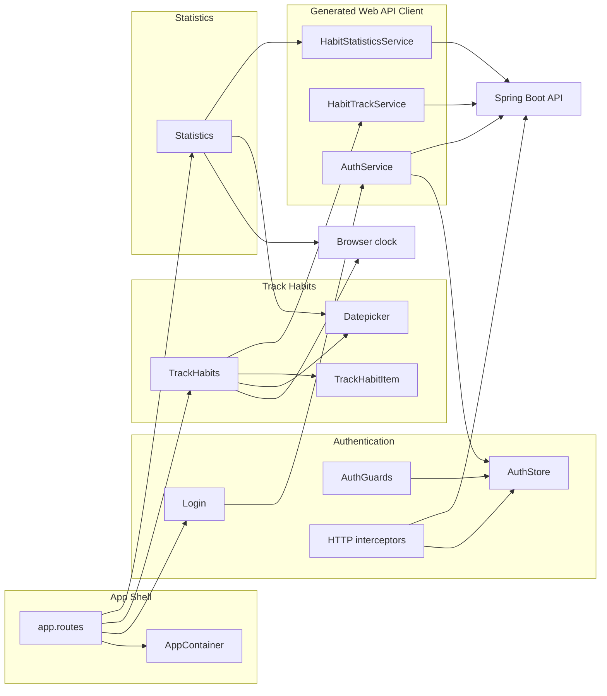

# Architecture — habit-tracker-angular

Synthesis of the developer scan for intent `timezone-today`. Component catalogue: [component-inventory.md](./component-inventory.md). Consumed HTTP surface: [api-documentation.md](./api-documentation.md).

## Architecture Analysis

### System Overview

A single-page Angular 18 application (`habit-tracker-ui`) in front of a sibling Spring Boot API. The browser hosts routing, forms, and an Elf-backed JWT session. All habit data crosses HTTP via `ng-openapi-gen` adapters under `src/app/web-api/`. There is no client-side domain service for *today*; constructors seed dates from `new Date()`.

### Architectural Style

**Layered SPA (modular monolith frontend)** — one deployable, one npm package, standalone components (`ht` prefix), generated HTTP port.

Evidence: `angular.json` application builder; no workspace-internal libraries; `environment.apiUrl` + `proxy.conf.json` for `/api` → `localhost:8080`.

Context mapping to the backend is **Conformist / Published Language**: the UI must adopt the API model. Domain law is not implemented here. An Anti-Corruption Layer for calendar *today* does not exist; `date-fns` `format(..., 'yyyy-MM-dd')` on a browser `Date` is used as if it were the server’s civil date.

### Component Relationships



Habit Management UI and shared widgets (streak, counter, confirm dialog, …) were skimmed only; they sit beside Track/Statistics in the shell and are not redrawn here.

### Data Flow

1. Unauthenticated users hit `/login`. `AuthService.login` stores JWT; interceptors attach `Authorization`.
2. Authenticated child routes render under `AppContainerComponent`.
3. **Track**: constructor `new Date()` → `currentDate` / `selectedDate` → `format` to `yyyy-MM-dd` → `GET /api/habit-track/{date}`. Check-in/unmark posts the same formatted `selectedDate` with `habitId`.
4. **Statistics**: field `currentDate = new Date()`; `startDate = startOfMonth(currentDate)`; `endDate = currentDate`; both formatted locally → `GET /api/statistics/{startDate}/{endDate}`.
5. Datepicker `maxDate` is that client `currentDate`. Options are applied once in `ngAfterViewInit`.
6. HTTP errors: track and login `subscribe()` success-only. Generated `ErrorResponse` is unused. Invalid timezone save (when added) has no existing error-surface pattern.

### Key Design Decisions

Observed choices (not new ADRs). Trade-offs recorded so Construction does not treat them as accidental.

| Decision | Context | Alternatives considered | Consequences |
|----------|---------|-------------------------|--------------|
| Client clock as domain today | No `/today` in checked-in OpenAPI; constructors need a `Date` for list, max, and payload | (A) Consume API today — blocked by current snapshot. (B) Keep `new Date()` — current. (C) User-picked “as of” without a server today — still invents civil date | Track/statistics/check-in can disagree with the user’s IANA today after midnight or TZ change |
| Generated OpenAPI client | `swagger/api-docs.json` + `ng-openapi-gen` | Hand-written HttpClient; runtime OpenAPI fetch | Fast CRUD; **regenerate required** before the UI can call today/timezone |
| Elf persist to `localStorage` | Session across refresh | Memory-only; cookie session | No timezone/today in session shape; settings will need a different store or API-backed profile |
| Domain law stays in backend | README / AGENTS.md | Duplicate rules in Angular services | UI must hide illegal actions only; do not re-implement enforcement |

### Improvement Opportunities

- Introduce a **single API-today source** consumed by Track default/max, Statistics default/max, and check-in payload (see Interaction Diagrams for the current coupling).
- Add settings (IANA view/change; UTC-backfill still editable; do not hide the field) plus regenerate `web-api`.
- First real **API-error surface** (`ErrorResponse`) for invalid timezone save — none exists.
- Datepicker must **re-init or update options** when max/today is swapped after first `ngAfterViewInit`.
- Do not fold check-in window, streak, or `status`→`done` into this intent.

## Interaction Diagrams

Current Track list + check-in path using **client-clock today** (constructor `new Date()`, local `yyyy-MM-dd`). This is the as-is transaction the intent must replace.

```mermaid
sequenceDiagram
    actor User
    participant Track as TrackHabitsComponent
    participant Clock as BrowserClock
    participant Fmt as DateFnsFormat
    participant Client as HabitTrackService
    participant API as HabitTrackAPI

    User->>Track: Open Track route
    Track->>Clock: new Date()
    Clock-->>Track: currentDate and selectedDate
    Track->>Fmt: format selectedDate yyyy-MM-dd
    Fmt-->>Track: local calendar date
    Track->>Client: getTrackingList date
    Client->>API: GET /api/habit-track/{date}
    API-->>Client: HabitTrackResponse list
    Client-->>Track: subscribe next
    Track-->>User: Render list maxDate is client currentDate

    User->>Track: Toggle check-in
    Track->>Fmt: format selectedDate yyyy-MM-dd
    Fmt-->>Track: same local date
    alt marked done
        Track->>Client: trackHabit body date habitId
        Client->>API: POST /api/habit-track
    else unmarked
        Track->>Client: untrackHabit body date habitId
        Client->>API: DELETE /api/habit-track
    end
    Client-->>Track: subscribe success only
    Track->>Client: refresh list
    Note over Track,API: ErrorResponse unused; no error UI
```

<!--
Text fallback — Track / check-in using client-clock today:
1. User opens the Track route.
2. TrackHabitsComponent constructor calls new Date() and assigns currentDate and selectedDate (track-habits.component.ts L49–50).
3. refresh() formats selectedDate with date-fns format(..., 'yyyy-MM-dd') in the browser's local timezone (L57–59).
4. HabitTrackService.getTrackingList sends GET /api/habit-track/{date}. The generated client requires that path param; there is no omit-for-today.
5. The list renders. Datepicker maxDate is the same client currentDate (track-habits.component.html). Air Datepicker options are set once in ngAfterViewInit.
6. On check-in or unmark, handleStatusChange formats the same selectedDate (L66–78) and POST or DELETE /api/habit-track with { date, habitId }.
7. subscribe() has a success path only (refresh). Generated ErrorResponse is never bound. A later invalid timezone save has no existing error-surface pattern.
Statistics (not drawn): currentDate = new Date(); startDate = startOfMonth(currentDate); endDate = currentDate; GET /api/statistics/{startDate}/{endDate} with the same local format.
-->

## Impact for Intent timezone-today

Blast radius is **high** and cross-cutting: Track Habits, Statistics, Datepicker, Generated Web API Client, and (new) App Shell settings. Authentication is involved only if settings errors reuse login’s missing error path. Habit Management UI is out of scope. Details: [component-inventory.md](./component-inventory.md).
