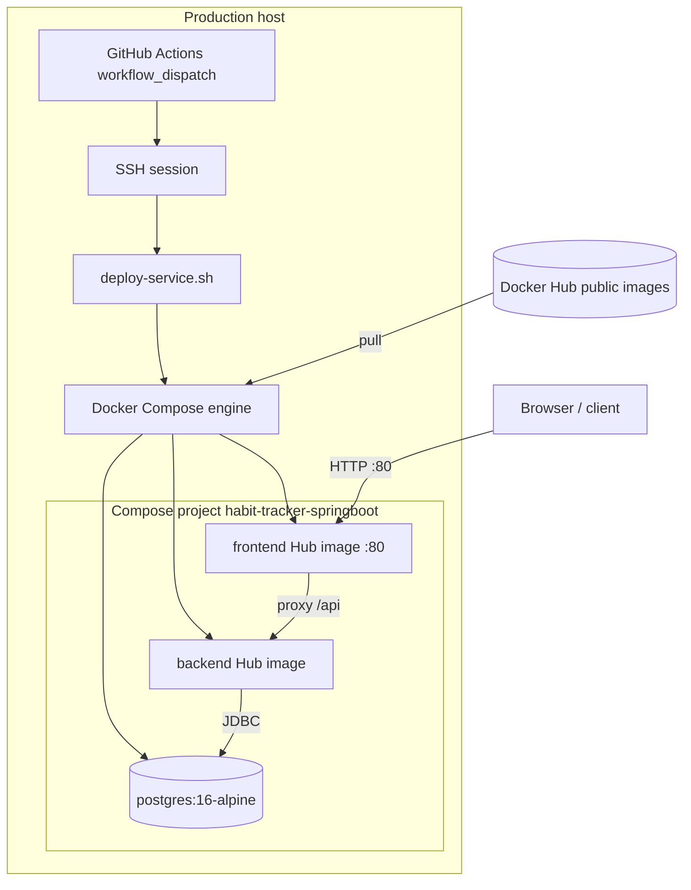
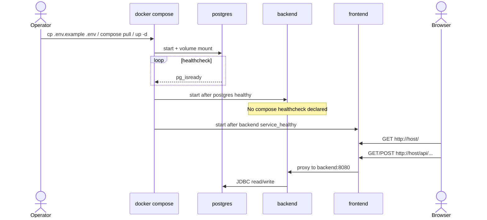
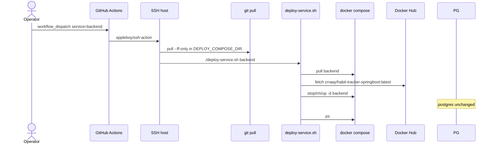
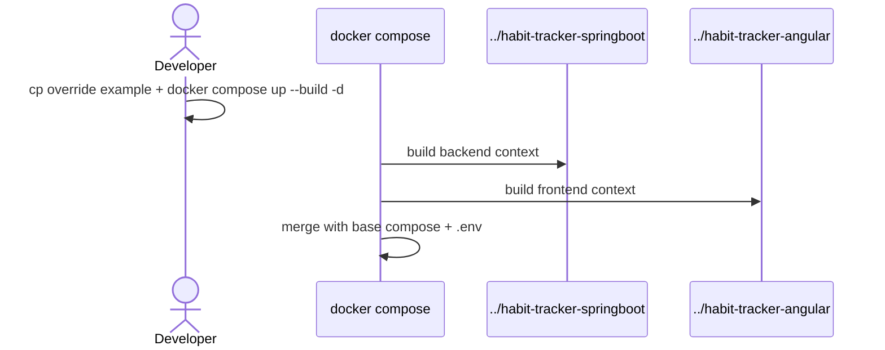

# Architecture

**Repo:** habit-tracker-compose  
**Scan kind:** full — see [reverse-engineering-timestamp.md](./reverse-engineering-timestamp.md)  
**Inventories:** runtime surfaces in [api-documentation.md](./api-documentation.md); components in [component-inventory.md](./component-inventory.md); stack in [technology-stack.md](./technology-stack.md)

## Architecture Analysis

### System Overview

A **configuration-driven orchestration satellite**: no application bytecode is compiled here. The system’s “runtime” is a Docker Compose project (`name: habit-tracker-springboot`) on a single host. Postgres holds state; backend and frontend run as immutable Hub images. The only published host port is **80** on the frontend container, which (in the Angular image, not defined in this repo) reverse-proxies `/api` to the backend on the Compose network.

Production changes flow: **app repos build/push images → operator runs deploy workflow → droplet pulls tags and recreates containers**. Compose file changes deploy via `git pull` on the droplet without rebuilding app images.

### Architectural Style

**Single-host multi-container composition** (not microservices orchestration platform):

- One Compose file defines colocated services on a default bridge network.
- No service mesh, no Kubernetes, no in-repo IaC.
- **Integration style:** synchronous HTTP at the edge (browser → frontend → backend); JDBC inside backend to `postgres:5432`.
- **Deploy style:** imperative shell over SSH (GitHub Actions → `deploy-service.sh`).

Evidence: only `docker-compose.yml`, no app source trees; `DOCKER.md` documents Hub-only production and manual deploy gate.

### Component Relationships

Text fallback: Operators trigger GHA → SSH to droplet → `git pull` + `deploy-service.sh` → Compose pulls Hub images and recreates `backend`/`frontend`. User traffic hits frontend:80; API calls go to backend via internal network; backend uses Postgres volume `habit-tracker-springboot_postgres_data`.

### Data Flow

1. **User request:** HTTP to host port 80 → `frontend` container (static UI + reverse proxy in sibling-built image).
2. **API request:** `/api/*` proxied to `backend:8080` (default Spring port from env).
3. **Persistence:** Backend uses `SPRING_DATASOURCE_URL=jdbc:postgresql://postgres:5432/...` with credentials from `.env`.
4. **Secrets:** `JWT_SECRET` and `CORS_ALLOWED_ORIGINS` injected at container start; not stored in this repo.
5. **Deploy data path:** No database migration in this repo; schema migrations ship inside the backend image (Flyway in app repo).

### Key Design Decisions

| Decision | Rationale | Implication |
|----------|-----------|-------------|
| Hub images only in committed `docker-compose.yml` | Droplet needs only this clone + `.env` | App changes require app-repo CI before deploy here |
| Compose project + volume names preserved from legacy backend-repo deploy | Avoid Postgres data loss on repo move | Names look like “backend repo” though stack is full-stack |
| `:latest` tags for both app images | Simplicity for small team | Manual coordination; no immutable deploy trace in compose |
| Postgres never recreated by deploy script | Safe rolling app updates | Schema drift handled only when backend image changes |
| Manual `workflow_dispatch` deploy | Explicit production gate | No automatic deploy on compose push |
| Optional override file for local `build` | Dev ergonomics without polluting production compose | Sibling repo layout required |

### Improvement Opportunities

- Add a **backend Compose healthcheck** (e.g. HTTP GET `/actuator/health`) so `frontend` `depends_on.backend.condition: service_healthy` is reliable across Compose versions.
- Pin **immutable image digests or version tags** instead of `latest` for reproducible production.
- Prefer **SSH key auth** over password secret for deploy workflow.
- Add **yamllint** or **compose config validate** in CI (even without app tests) to catch schema errors early.
- Document expected **backend health endpoint path** in this repo once healthcheck is added (cross-link to springboot Dockerfile if defined there).

## Interaction Diagrams

### Runtime: first boot on a host (Hub images)

### Deploy: GitHub Actions → droplet (backend only example)

### Local dev: override build path (optional)

<!-- Text fallback for diagrams: Runtime boot order is postgres (healthchecked) → backend → frontend with healthy dependency. Deploy pulls selected services from Hub and recreates containers. Local override builds from sibling directories. -->
