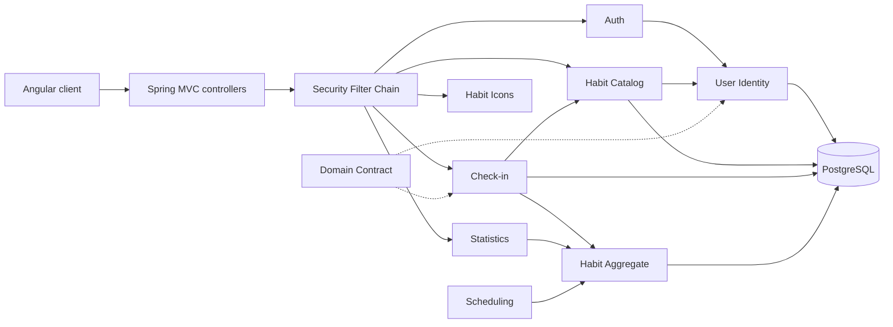
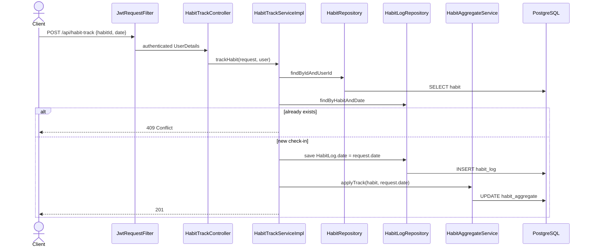
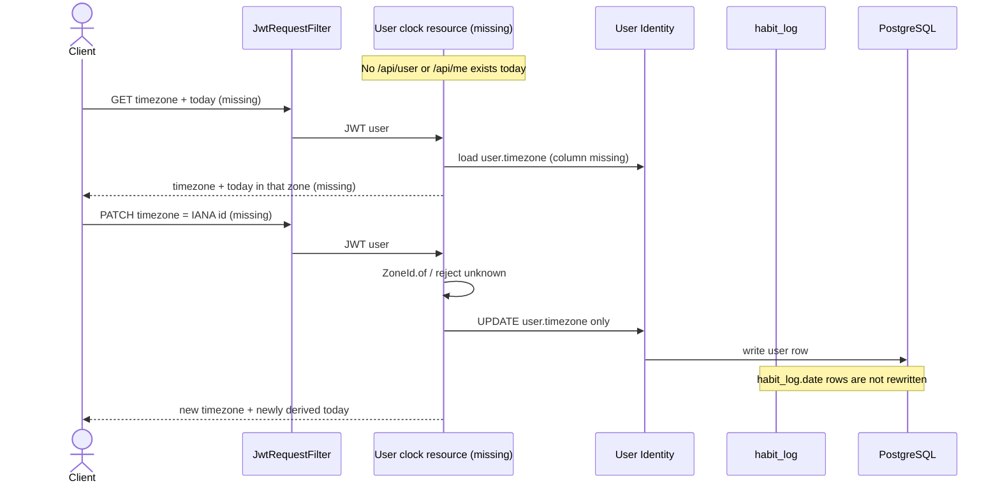

# Architecture

**Repo:** habit-tracker-springboot  
**Scan kind:** partial — see [reverse-engineering-timestamp.md](./reverse-engineering-timestamp.md)  
**Inventories:** APIs in [api-documentation.md](./api-documentation.md); components in [component-inventory.md](./component-inventory.md); stack in [technology-stack.md](./technology-stack.md)

## Architecture Analysis

### System Overview

A single Maven JAR (`com.kostya:habit-tracker-springboot`) exposing a JWT-protected REST API. One PostgreSQL schema is the persistence boundary. The Angular client is a sibling repo; this backend does not serve UI. Domain law lives in `docs/domain.md` and is **ahead** of the code for timezone and today.

### Architectural Style

**Layered modular monolith** (single deployable, package-by-layer under `com.kostya.habittracker`):

- Adapter: `controller/`, `filter/`, `scheduled/`
- Application: `service/` + `service/impl/`
- Persistence: `entity/`, `repository/`, Flyway SQL
- Cross-cutting: `config/`, `exception/`, `aspect/` (aspect skimmed)

Evidence: one module in `pom.xml`; no inter-service messaging; `ddl-auto=validate` plus Flyway V1–V5. Not microservices, not serverless.

Internal packages are technical layers, not bounded contexts. Ownership is still clear enough for issue 14: **User Identity** owns timezone; **Check-in** owns `habit_log.date` and must not rewrite it when timezone changes.

### Component Relationships

Text fallback for the component map is in the HTML comment after Interaction Diagrams.

### Data Flow

1. Request hits `JwtRequestFilter` then a controller (except public `/api/auth/**`, health, OpenAPI).
2. Controller takes `@AuthenticationPrincipal UserDetails` and DTOs; services load owner-scoped entities.
3. Check-in writes `HabitLog.date` as `DATE` / `LocalDate` (the check-in identity) and updates `HabitAggregate`.
4. Scheduler independently computes `LocalDate.now(ZoneId.of(app.scheduling.timezone))` and resets streaks — **ops clock**, not user clock.
5. There is **no** path that reads or writes `user.timezone` or returns server `today`.

### Key Design Decisions

| Decision | Implication for issue 14 |
|----------|--------------------------|
| Canonical law in `docs/domain.md`; backend enforces | Add timezone/today to match the glossary; do not invent a second clock. |
| Check-in identity is `habit_log.date` DATE | Timezone PATCH must update only `user.timezone`. Leave log dates untouched. |
| JWT + `anyRequest().authenticated()` | New GET/PATCH for timezone/today needs a new resource (no `/api/user` or `/api/me` today) behind JWT. |
| Flyway V1–V5; JPA validate | New column via V6+ with UTC backfill then NOT NULL. |
| Test profile disables Flyway, `ddl-auto=create-drop` | A NOT NULL timezone migration will not run in the current suite unless tests change. |
| `app.scheduling.timezone` | Do not reuse as the user clock. Streak-job TZ is out of this package. |

Observed vs intended: domain already requires `user.timezone` + derived today; code has neither. `@PastOrPresent` on track dates uses the JVM clock — window enforcement is a later package; this package’s stopgap is exposing server `today`.

### Improvement Opportunities

- Add authenticated user clock resource (`timezone` + derived `today`); reject unknown IANA ids; map via existing `BadRequestException` → 400.
- Backfill existing users to UTC in Flyway; document UTC as migration default, not product TZ.
- Seed `testuser` with a zone after the column exists.
- Do not couple user today to `SchedulingConfig.applicationTimeZone()`.
- Later packages (not this scan’s work): today\|yesterday window, live-streak rule vs midnight zeroing, `status` → `done`.

## Interaction Diagrams

Current mark-done path (what exists). Client supplies the calendar date; the server does not derive today.

Issue-14 gap: there is no today/timezone transaction. Intended shape (not implemented) — timezone change must not touch `habit_log`.

<!--
Text fallback — component map:
Angular client → Spring MVC controllers → Security Filter Chain → Auth, Habit Catalog, Check-in, Statistics, Habit Icons.
Auth and Habit Catalog depend on User Identity. Check-in depends on Habit Catalog and Habit Aggregate. Statistics reads aggregates. Scheduling (ops) writes Habit Aggregate using app.scheduling.timezone. All persist to one PostgreSQL schema. Domain Contract is the law for User Identity and Check-in; it is not a runtime component.

Text fallback — check-in sequence:
Client POSTs /api/habit-track with habitId and a LocalDate. JWT filter authenticates. HabitTrackServiceImpl loads the habit by id+user, rejects a duplicate (habit_id, date) with 409, inserts habit_log.date as the client date, then updates HabitAggregate. The server does not compute today from user.timezone.

Text fallback — timezone/today (missing):
No user-clock resource exists. Intended GET returns stored IANA timezone plus today derived in that zone. Intended PATCH validates the IANA id, updates only user.timezone, and leaves habit_log.date unchanged. After the change, today is computed in the new zone.
-->
