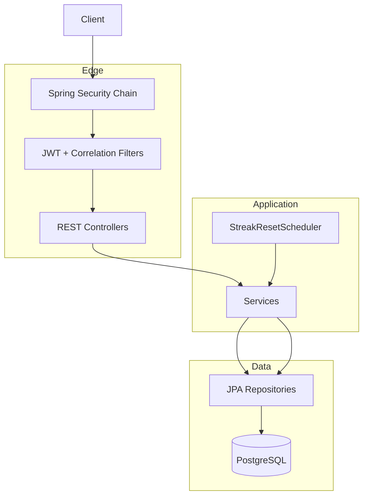
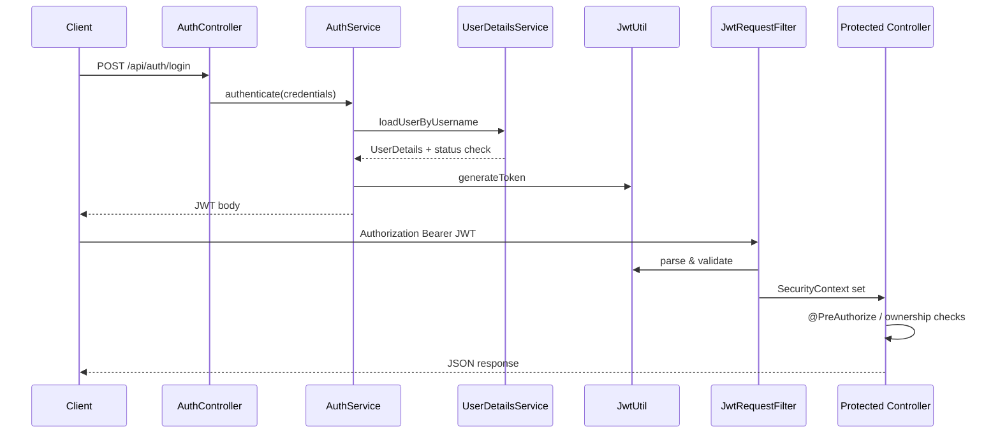
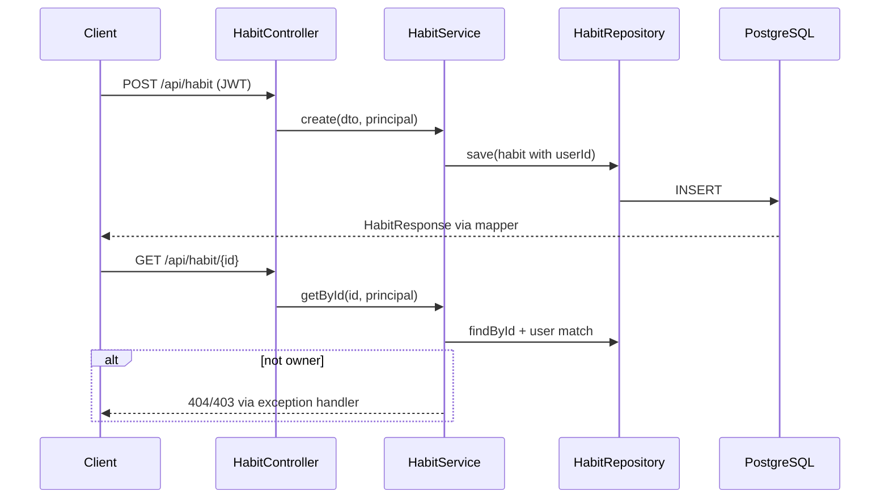
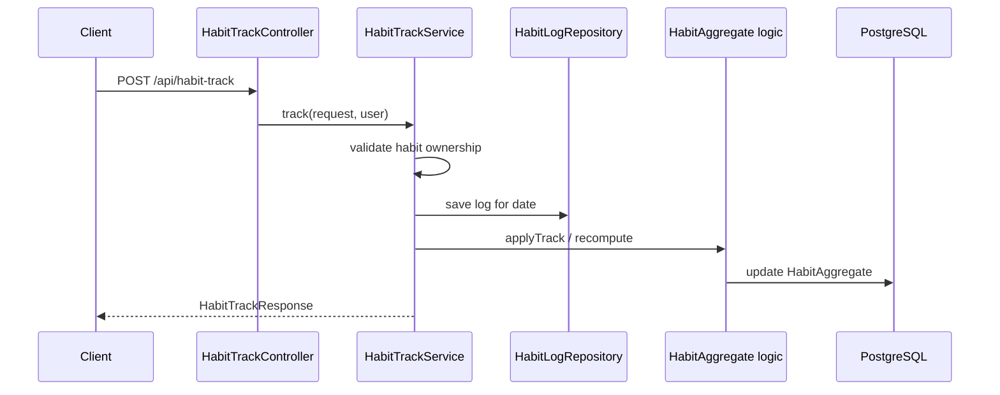
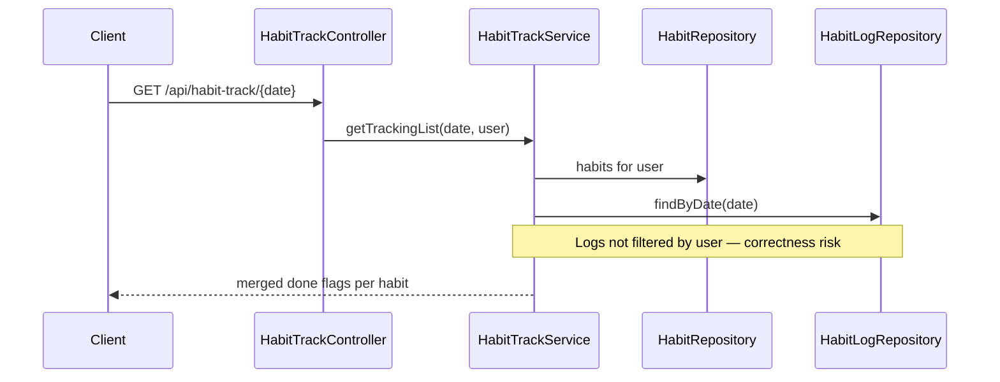
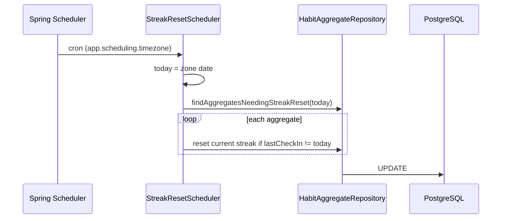
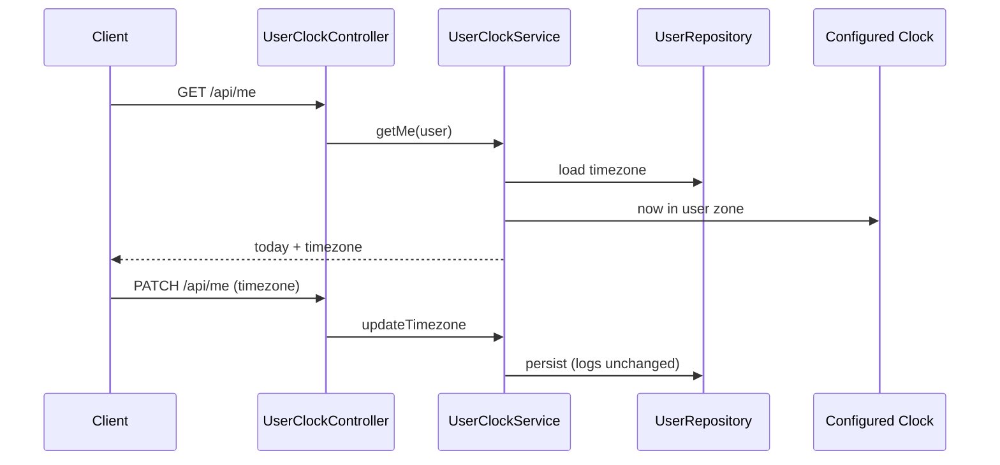

# Architecture — habit-tracker-springboot

## Architecture Analysis

### System Overview

A **layered monolith**: Spring Boot 3.5 hosts REST controllers, transactional services, Spring Data JPA repositories, and PostgreSQL (Flyway migrations). Stateless **JWT** secures `/api/**`; actuator and OpenAPI endpoints are public. One scheduled job resets streaks on a cron in a **single configured timezone**.

Cross-references: [component-inventory.md](./component-inventory.md), [code-structure.md](./code-structure.md), [business-overview.md](./business-overview.md).

### Architectural Style

| Style | Evidence |
|-------|----------|
| **Monolithic deployable** | Single Maven module, one JAR/Docker image |
| **Layered (ports & adapters lite)** | `controller` → `service` → `repository` → `entity`; DTOs + manual mappers at the edge |
| **Database-centric domain** | JPA entities are the persistence model; aggregates stored in `HabitAggregate` |

Not microservices, not event-driven; synchronous HTTP request/response only.

### Component Relationships

### Data Flow

- **Write path**: Controller validates DTO → service enforces user scope (mostly) → repository persists entity → mappers shape responses.
- **Read path**: Repository queries by user and/or date → service merges habits with log/aggregate state → DTO response.
- **Streak maintenance**: Inline updates on track/untrack plus nightly batch comparing `lastCheckInDate` to scheduler “today”.

### Key Design Decisions

1. **Stateless JWT** — No server sessions; `JwtRequestFilter` populates security context per request ([Security and JWT](./component-inventory.md#security-and-jwt)).
2. **Manual mappers** — No MapStruct; explicit mapping classes keep dependencies minimal.
3. **Validated schema** — `ddl-auto=validate` + Flyway V1–V6; schema is source of truth in SQL migrations.
4. **User timezone as column** — V6 adds timezone; clock service computes `today` without rewriting `HabitLog.date` (intentional immutability of logged dates).
5. **Global scheduler timezone** — `app.scheduling.timezone` drives cron “today”, not each owner’s zone (misalignment with domain doc).

### Improvement Opportunities

- Align check-in validation and streak reset with **per-user today** and domain lifecycle.
- Scope all log queries by **user** (see `HabitTrackServiceImpl.getTrackingList` risk in [code-quality-assessment.md](./code-quality-assessment.md)).
- Harden production bootstrap (disable dev `DataInitializer`, externalize secrets).
- Expand automated tests around habit CRUD, tracking, streaks, and auth edge cases.

## Interaction Diagrams

### Login and authenticated request

### Habit CRUD (owner-scoped)

### Mark check-in (track)

### Daily tracking list

### Streak reset (scheduled)

### User clock (timezone / today)

