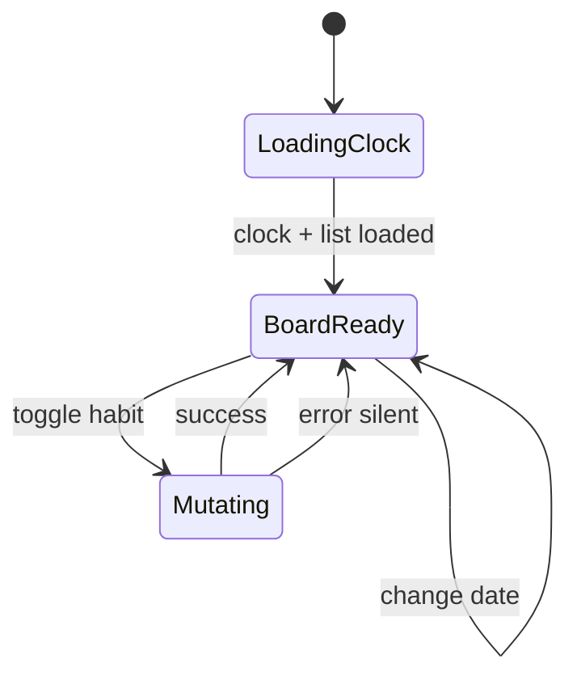

# Functional specification — unit `habit-tracker-angular`

Self-contained behavioral spec for U2 (planning reference, Bolt **F2**). Interaction rules live in the YAML block below (no separate `rules.md` for `ui` kind).

## Interaction rules (source of truth)

```yaml
rules:
  - id: BR1.1
    category: implemented
    statement: Successful login persists JWT and username in Elf localStorage (ht_auth).
    applies_to: [SpaAuthentication]
    trigger: Login form submit
    logic: IF credentials accepted THEN store token via AuthStore ELSE remain on login (error UX gap — US2.5).
    source: [AC1.1.1]

  - id: BR1.2
    category: implemented
    statement: Stored JWT survives browser refresh until expiry or logout.
    applies_to: [SpaAuthentication]
    trigger: App bootstrap with persisted auth
    logic: AuthStore rehydrates; authGuard allows shell routes.
    source: [AC1.1.3]

  - id: BR2.1
    category: implemented
    statement: Protected routes require authenticated AuthStore state.
    applies_to: [SpaAppShell, SpaAuthentication]
    trigger: Navigation to /track, /edit, /statistics, /settings
    logic: authGuard on AppContainer children; unauthenticated users redirect to /login.
    source: [AC1.2.1]

  - id: BR2.2
    category: implemented
    statement: HTTP 401 clears session and routes to login.
    applies_to: [SpaSharedPresentation]
    trigger: API 401 response
    logic: refresh-token interceptor clears auth and navigates to login (no refresh token rotation).
    source: [AC1.11.2]

  - id: BR2.3
    category: implemented
    statement: Logout clears stored credentials.
    applies_to: [SpaAppShell]
    trigger: User selects Logout
    logic: Clear AuthStore; navigate to login.
    source: [AC1.11.1]

  - id: BR3.1
    category: implemented
    statement: User clock is loaded once per session via GET /api/me and cached.
    applies_to: [SpaUserClock]
    trigger: First UserClockStore.getClock() consumer
    logic: shareReplay(1) on generated UserClockService.getMe(); exposes today (ISO date) and timezone.
    source: [AC1.3.1]

  - id: BR3.2
    category: implemented
    statement: Settings timezone save shows API error message on failure.
    applies_to: [SpaUserClock, Settings]
    trigger: PUT /api/me from Settings save
    logic: On HttpErrorResponse set errorMessage from err.error.message; on success applyTimezoneUpdate preserves in-session today.
    source: [AC1.3.2]

  - id: BR4.1
    category: implemented
    statement: Track board loads habits for selected civil date from API.
    applies_to: [SpaTrackHabits]
    trigger: Route /track or date change
    logic: Format selected date yyyy-MM-dd; GET habit-track list; render done state per row.
    source: [AC1.4.1, AC1.4.2]

  - id: BR4.2
    category: implemented
    statement: Toggle done calls POST or DELETE /api/habit-track with habitId and date.
    applies_to: [SpaTrackHabits, TrackHabitItem]
    trigger: User toggles habit row
    logic: Mutate via generated HabitTrackService; optimistic UI update on success (error path often silent — gap US2.5).
    source: [AC1.5.1, AC1.6.1]

  - id: BR4.3
    category: implemented
    statement: Track datepicker caps selection at server today (maxDate).
    applies_to: [SpaTrackHabits, Datepicker]
    trigger: Date selection
    logic: maxDate bound to UserClockStore today; no minDate enforced in as-built UI.
    source: [AC1.4.2]

  - id: BR5.1
    category: implemented
    statement: Edit habits uses habit CRUD generated client scoped by auth.
    applies_to: [SpaHabitManagementUI]
    trigger: /edit routes
    logic: List/create/update/delete via HabitMgmtService; icon picker uses HabitIconsService.
    source: [AC1.7.1, AC1.7.2, AC1.8.1, AC1.9.1]

  - id: BR6.1
    category: implemented
    statement: Statistics default range is month start through server today.
    applies_to: [SpaStatistics]
    trigger: /statistics load
    logic: startOfMonth(today) .. today from clock; GET statistics aggregated data.
    source: [AC1.10.1, AC1.10.2]

  - id: BR7.1
    category: implemented
    statement: Shell exposes primary navigation (desktop + mobile patterns).
    applies_to: [SpaAppShell]
    trigger: Authenticated layout
    logic: Nav links to track, edit, statistics, settings; default redirect / → track.
    source: [AC1.2.1]

  - id: BR8.1
    category: implemented
    statement: Bearer token attached to API calls via functional interceptor.
    applies_to: [SpaSharedPresentation]
    trigger: Outbound HttpClient request
    logic: token.interceptor reads AuthStore and sets Authorization header when token present.
    source: [AC1.1.1]

  - id: BR9.1
    category: backlog
    enforcement: non-enforcing
    statement: Login and track mutations show ErrorResponse message like Settings.
    applies_to: [Login, SpaTrackHabits]
    source: [AC2.5.1, US2.5]

  - id: BR9.2
    category: backlog
    enforcement: non-enforcing
    statement: Track datepicker minDate enforces today/yesterday window in user TZ.
    applies_to: [SpaTrackHabits]
    source: [AC2.2.1, AC1.5.2]

  - id: BR9.3
    category: backlog
    enforcement: non-enforcing
    statement: Silent JWT renewal before expiry.
    applies_to: [SpaAuthentication]
    source: [AC2.7.1, US2.7]

  - id: BR9.4
    category: backlog
    enforcement: non-enforcing
    statement: Statistics display reflects scheduled-day semantics when backend supports schedules.
    applies_to: [SpaStatistics]
    source: [AC2.4.1]
```

## Rules summary (derived)

| Category | BR ids |
|----------|--------|
| Implemented | BR1.1–BR1.2, BR2.1–BR2.3, BR3.1–BR3.2, BR4.1–BR4.3, BR5.1, BR6.1, BR7.1, BR8.1 |
| Backlog | BR9.1–BR9.4 |

---

## WF-1 — Authentication (SpaAuthentication)

1. User opens `/login` (`noAuthGuard` prevents access when already authenticated).
2. Submit credentials → generated `AuthService.login`.
3. On success persist token + username in Elf `AuthStore` (BR1.1).
4. Navigate into shell; subsequent requests use token interceptor (BR8.1).
5. On failure remain on login — **gap:** no Settings-style error banner (BR9.1 backlog).

---

## WF-2 — App shell (SpaAppShell)

1. Root route loads `AppContainerComponent` with `authGuard` on children (BR2.1).
2. Default child redirect to `/track` (BR7.1).
3. Nav renders Track, Edit habits, Statistics, Settings, Logout.
4. Logout clears auth and returns to login (BR2.3).

---

## WF-3 — User clock (SpaUserClock)

1. Feature screens call `UserClockStore.getClock()` (BR3.1).
2. Store issues single shared `GET /api/me`; consumers receive `{ timezone, today }`.
3. Settings loads form from clock; save calls `updateMe` (BR3.2).
4. Success applies `applyTimezoneUpdate` (timezone changes; today unchanged in-session per product rule).

---

## WF-4 — Track habits (SpaTrackHabits)

1. Initialize `currentDate` from parsed clock.today (BR4.1).
2. Load board via `getTrackingList` for formatted date.
3. Datepicker changes reload list (BR4.3 maxDate = today).
4. Toggle row → track or untrack API (BR4.2).
5. **Backlog:** minDate/window UX (BR9.2); mutation errors (BR9.1).

**Screen state (conceptual):**



---

## WF-5 — Habit management UI (SpaHabitManagementUI)

1. `/edit` lists habits via management API.
2. Create/update name and icon (icon picker → habit icons catalog) (BR5.1).
3. Delete with confirmation dialog pattern.

---

## WF-6 — Statistics (SpaStatistics)

1. Seed range from clock today: month start .. today (BR6.1).
2. User adjusts datepicker range → refresh aggregated API.
3. Render per-habit completion vs total days in range.

---

## WF-7 — Shared presentation (SpaSharedPresentation)

1. `token.interceptor` attaches Bearer JWT (BR8.1).
2. `refresh-token.interceptor` handles 401 → clear auth, login route (BR2.2).
3. Material/animations/shared widgets (datepicker, dialogs, streak display components) reused by features.

---

## WF-8 — API client boundary

1. All HTTP paths/types from checked-in `swagger/api-docs.json`.
2. Regenerate via `npm run generate-api`; **never hand-edit** `src/app/web-api/` (team mandate).
3. Feature mapping: AuthService, UserClockService, HabitTrackService, HabitMgmtService, HabitStatisticsService, HabitIconsService.

---

## Cross-reference to backend

U1 functional design owns REST semantics (C1). U2 conforms to OpenAPI snapshot; domain law remains `habit-tracker-springboot/docs/domain.md` — UI hides illegal actions but does not re-derive server rules.
