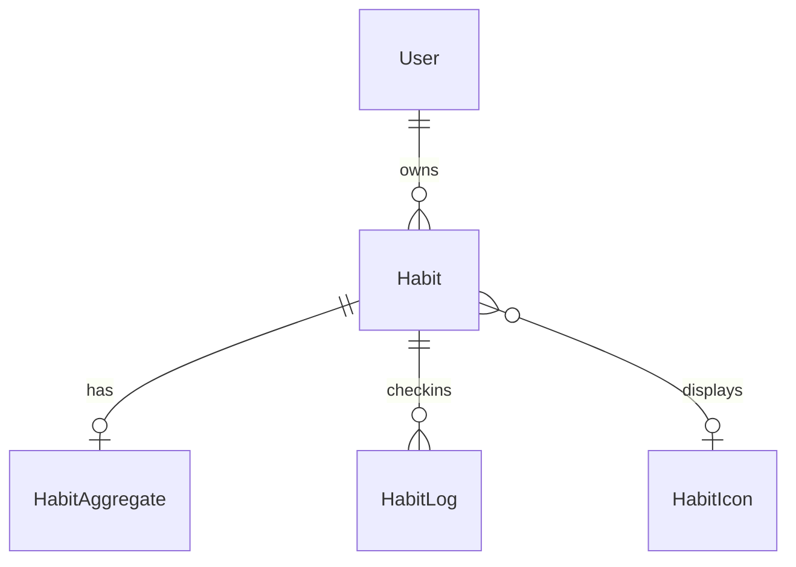
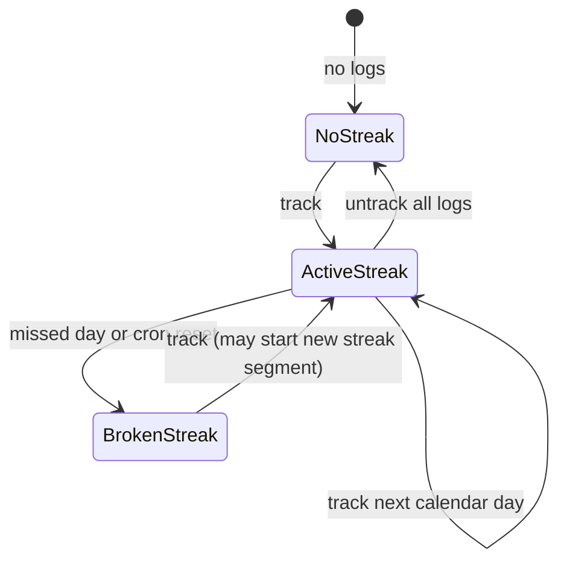

# Functional specification — unit `habit-tracker-springboot`

Behavioral source of truth for U1 workflows and aggregate lifecycle. Derived views: entity diagram (from `entities.md`), rules table (from `rules.md`).

## Entity relationship (derived)

## Rules summary (derived)

| Area | Implemented BR ids | Backlog BR ids |
|------|-------------------|----------------|
| Auth | BR1.1, BR1.2, BR8.1 | BR14.1 |
| User clock | BR2.1, BR2.2 | — |
| Habits | BR3.1, BR3.2 | BR10.1 |
| Check-in | BR4.1–BR4.3 | BR11.1 |
| Streak | BR5.1, BR5.2 | BR12.1 |
| Statistics | BR6.1 | BR13.1 |
| Icons | BR7.1 | — |
| Errors | BR9.1 | — |

---

## WF-1 — Authentication (BackendAuthentication)

1. Client sends `POST /api/auth/login` with username and password (public route).
2. Service loads user by username; missing user → BR1.1 violation (401).
3. Password mismatch → increment failedLoginAttempts, save, 401 generic message.
4. Status not ACTIVE or role not USER → 401 with specific message (BR1.2).
5. On success update lastLoginAt; build HS256 JWT with configured expiry; return token and tokenExpiresIn seconds.
6. Subsequent API calls include `Authorization: Bearer <token>`; JwtRequestFilter validates and binds User to security context (BR8.1).

**State:** Session is stateless; no server-side session store.

---

## WF-2 — User clock (BackendUserClock)

1. Authenticated client calls `GET /api/me`.
2. Service reads user.timezone; validates IANA id; computes `today` using Clock in that zone (BR2.1).
3. Returns UserClockResponse `{ timezone, today }`.
4. `PUT /api/me` with new timezone → validate zone (BR2.2); persist; return refreshed response.

---

## WF-3 — Habit management (BackendHabitManagement)

1. List/create/update/delete via `/api/habit` endpoints under authenticated context.
2. All lookups use current user id (BR3.1, BR8.2).
3. Create/update may set name and optional icon reference (BR3.2).
4. Delete removes habit (cascade to logs/aggregate per DB constraints).

**Lifecycle states:** Not modeled in as-built entity (see backlog WF-10).

---

## WF-4 — Habit icon catalog (BackendHabitIconCatalog)

1. Authenticated `GET /api/habit-icons` (BR7.1).
2. Service returns catalog entries (active icons) for picker consumption.

---

## WF-5 — Check-in tracking (BackendCheckInTracking)

1. **Board:** `GET /api/habit-track/{date}` loads user habits; marks done if log exists for date (BR4.1). *Note: log query by date alone may include other users' logs in mark set — as-built behavior; follow-up hardening should scope by user.*
2. **Track:** `POST /api/habit-track` with habitId and date → verify ownership (BR4.2); reject duplicate log (409); insert HabitLog; invoke aggregate applyTrack (WF-6 step 2).
3. **Untrack:** `DELETE /api/habit-track` → verify ownership; require existing log (BR4.3); delete log; recompute aggregate.

**Check-in window:** No server-side today/yesterday enforcement as-built (backlog WF-11).

---

## WF-6 — Streak and aggregate (BackendStreakAndAggregate)

**On track (inline):**

1. After log insert, applyTrack updates HabitAggregate counters for contiguous dates (BR5.1).
2. Non-contiguous or backfill paths trigger full recompute from ordered logs.

**On untrack:**

1. applyUntrack always recomputes aggregate from remaining logs.

**Scheduled reset (StreakResetScheduler):**

1. If `app.scheduling.streak-reset.enabled`, cron fires in `app.scheduling.timezone` (default Asia/Bangkok, 23:55).
2. Compute `today` in that zone (not each user's zone) — **gap vs BR12.1**.
3. resetStreaksForUncheckedHabits(today) zeroes currentStreak where repository rules indicate missed day (BR5.2).

**Aggregate state machine (conceptual):**

---

## WF-7 — Statistics (BackendStatistics)

1. `GET /api/statistics/{startDate}/{endDate}` with authenticated user.
2. Compute inclusive day count between bounds (BR6.1).
3. Load user habits; count logs in range per habit; return completion counts and totalDays for each habit (including zero-completion habits).

**Scheduled-day semantics:** Not applied (backlog BR13.1).

---

## WF-8 — Cross-cutting security and errors

**Security workflow:**

1. CorrelationIdFilter assigns/propagates correlation id to MDC.
2. Protected routes without JWT → RestAuthenticationEntryPoint → 401 JSON (BR8.1).
3. Forbidden access → RestAccessDeniedHandler → 403 JSON.

**Error workflow (GlobalExceptionHandler — BR9.1):**

| Exception / source | HTTP | error label |
|--------------------|------|-------------|
| MethodArgumentNotValid | 400 | Bad request |
| BadRequestException | 400 | Bad request |
| UnauthorizedException | 401 | Unauthorized |
| ForbiddenException | 403 | Forbidden |
| NotFoundException | 404 | Not found |
| ConflictException | 409 | Conflict |
| Other Exception | 500 | Internal server error |

All bodies use ErrorResponse: status, error, message, path, correlationId, timestamp.

---

## WF-9 — Operational (appendix)

1. `GET /actuator/health` permitted without auth for compose health checks.
2. Swagger/OpenAPI paths permitted without auth (ops/dev; not SPA prod path).

---

## Backlog workflows (non-enforcing)

**WF-10 — Lifecycle (BR10.1):** Pause/archive/remove from track board until resumed.

**WF-11 — Check-in window (BR11.1):** Reject track dates outside user today/yesterday.

**WF-12 — User-relative streak cron (BR12.1):** Per-user midnight scheduling.

**WF-13 — Scheduled statistics (BR13.1):** Denominator reflects habit schedule.

**WF-14 — Token refresh (BR14.1):** Renewal endpoint or rotation policy.
