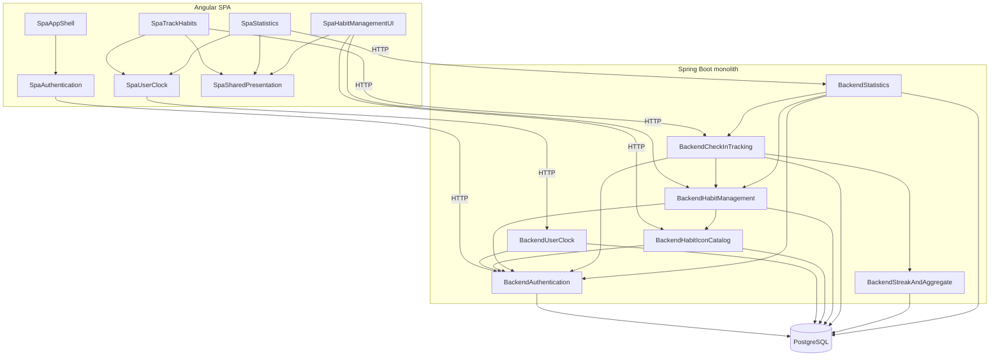

# Component Catalogue — intent `260914-full-repo-scan`

Brownfield **as-built** logical building blocks for `habit-tracker-springboot` and `habit-tracker-angular`. Compose deploy is **out of scope** for this file (Q1-A). Deployment grouping is deferred to Units Generation.

Sources: CodeKB inventories, entity scan, `domain-design-questions.md` (confirmed).

```yaml
components:
  - name: BackendAuthentication
    summary: Login, JWT issuance, and request authentication for the REST API.
    behaviour: >
      Accepts credentials on POST /api/auth/login; loads User via Spring Security;
      rejects inactive users; issues JWT; JwtRequestFilter validates Bearer tokens on
      /api/**; RestAuthenticationEntryPoint and RestAccessDeniedHandler return JSON errors;
      correlation-id filter attaches tracing metadata.
    responsibilities:
      - Credential verification and JWT lifecycle
      - Per-request security context for API adapters
      - JSON 401/403 responses at the edge
    depends_on: []
    dependents:
      - component: BackendUserClock
        interaction: Protected /api/me requires authenticated principal
        style: sync
      - component: BackendHabitManagement
        interaction: Habit CRUD requires authenticated owner
        style: sync
      - component: BackendCheckInTracking
        interaction: Track endpoints require authenticated user scope
        style: sync
      - component: BackendStatistics
        interaction: Statistics endpoints require authenticated user scope
        style: sync
      - component: BackendHabitIconCatalog
        interaction: Icon list is authenticated read
        style: sync
    external_dependencies:
      - name: PostgreSQL
        kind: database
        purpose: User persistence via JPA repositories
    entities:
      - name: User
        identifier: id
        attributes:
          - id
          - username
          - password
          - email
          - status
          - role
          - failedLoginAttempts
          - timezone
          - lastLoginAt
          - passwordChangedAt
          - createdAt
          - modifiedAt
          - createdBy
          - modifiedBy
        references: []

  - name: BackendUserClock
    summary: Server-authoritative today and timezone for the authenticated user.
    behaviour: >
      GET /api/me returns civil today (yyyy-MM-dd) and IANA timezone computed from the
      stored user zone; PUT /api/me updates timezone; does not rewrite historical HabitLog dates.
    responsibilities:
      - User-relative calendar day for clients
      - Timezone persistence on User
    depends_on:
      - component: BackendAuthentication
        interaction: Requires authenticated principal and User row
        style: sync
    dependents:
      - component: SpaUserClock
        interaction: SPA consumes /api/me via generated client
        style: sync
    external_dependencies:
      - name: PostgreSQL
        kind: database
        purpose: Read/update User.timezone
    entities: []

  - name: BackendHabitIconCatalog
    summary: Read-only catalog of habit icons for picker UI.
    behaviour: >
      Lists active icons from habit_icon table; exposes GET /api/habit-icons for clients.
    responsibilities:
      - Icon metadata and active flag
    depends_on:
      - component: BackendAuthentication
        interaction: Authenticated read
        style: sync
    dependents:
      - component: BackendHabitManagement
        interaction: Habits reference icon_id
        style: sync
      - component: SpaHabitManagementUI
        interaction: Icon picker loads catalog
        style: sync
    external_dependencies:
      - name: PostgreSQL
        kind: database
        purpose: HabitIcon rows
    entities:
      - name: HabitIcon
        identifier: id
        attributes:
          - id
          - name
          - description
          - s3Url
          - isActive
          - createdAt
          - modifiedAt
          - createdBy
          - modifiedBy
        references: []

  - name: BackendHabitManagement
    summary: User-scoped habit definition CRUD.
    behaviour: >
      Create/read/update/delete habits owned by the authenticated user; map entities to DTOs;
      enforce ownership on get/update/delete; associate optional HabitIcon.
    responsibilities:
      - Habit lifecycle in persistence (as-built schema)
      - Owner-scoped habit queries
    depends_on:
      - component: BackendAuthentication
        interaction: Principal identifies habit owner
        style: sync
      - component: BackendHabitIconCatalog
        interaction: Optional icon reference on habit
        style: sync
    dependents:
      - component: BackendCheckInTracking
        interaction: Tracking list joins habits for user/date
        style: sync
      - component: BackendStatistics
        interaction: Statistics aggregate per habit in range
        style: sync
      - component: SpaHabitManagementUI
        interaction: SPA CRUD via /api/habit
        style: sync
    external_dependencies:
      - name: PostgreSQL
        kind: database
        purpose: Habit rows and FK to User, HabitIcon
    entities:
      - name: Habit
        identifier: id
        attributes:
          - id
          - name
          - createdAt
          - modifiedAt
          - createdBy
          - modifiedBy
        references:
          - entity: User
            owned_by: BackendAuthentication
            relationship: each Habit belongs to one User
          - entity: HabitIcon
            owned_by: BackendHabitIconCatalog
            relationship: optional icon for display
          - entity: HabitAggregate
            owned_by: BackendStreakAndAggregate
            relationship: one aggregate row per habit when present

  - name: BackendStreakAndAggregate
    summary: Streak counters and nightly batch reset logic.
    behaviour: >
      Maintains HabitAggregate on track/untrack; StreakResetScheduler runs on cron using
      app.scheduling.timezone global today (as-built); recomputes current/best streak fields.
    responsibilities:
      - Aggregate row lifecycle tied to habit
      - Scheduled streak reset batch
    depends_on: []
    dependents:
      - component: BackendCheckInTracking
        interaction: applyTrack / recompute on check-in changes
        style: sync
    external_dependencies:
      - name: PostgreSQL
        kind: database
        purpose: habit_aggregate table
      - name: SchedulingConfig
        kind: other
        purpose: Cron trigger and configured zone for batch
    entities:
      - name: HabitAggregate
        identifier: habitId
        attributes:
          - habitId
          - totalCheckIns
          - currentStreak
          - bestStreak
          - lastCheckInDate
          - streakStartDate
          - createdAt
          - modifiedAt
          - createdBy
          - modifiedBy
        references:
          - entity: Habit
            owned_by: BackendHabitManagement
            relationship: aggregate shares primary key with habit

  - name: BackendCheckInTracking
    summary: Daily check-in list, track, and untrack for a civil date.
    behaviour: >
      GET /api/habit-track/{date} returns habits with done state for user; POST/DELETE
      /api/habit-track mutates HabitLog; delegates streak updates to aggregate logic;
      validates dates per as-built service rules (domain-doc window gaps noted in ADRs).
    responsibilities:
      - HabitLog create/delete for user+habit+date
      - Merge habit list with log state for UI
    depends_on:
      - component: BackendAuthentication
        interaction: User scope on all log access
        style: sync
      - component: BackendHabitManagement
        interaction: Habits included in tracking list
        style: sync
      - component: BackendStreakAndAggregate
        interaction: Update streak counters on mutations
        style: sync
    dependents:
      - component: SpaTrackHabits
        interaction: SPA track screen
        style: sync
    external_dependencies:
      - name: PostgreSQL
        kind: database
        purpose: habit_log table
    entities:
      - name: HabitLog
        identifier: id
        attributes:
          - id
          - date
          - createdAt
          - modifiedAt
          - createdBy
          - modifiedBy
        references:
          - entity: Habit
            owned_by: BackendHabitManagement
            relationship: each log belongs to one Habit

  - name: BackendStatistics
    summary: Completion counts for habits over a date range.
    behaviour: >
      GET /api/statistics/{startDate}/{endDate} aggregates check-ins for the authenticated
      user; semantics follow as-built queries (may differ from domain scheduled-day rules).
    responsibilities:
      - Range statistics DTO assembly
    depends_on:
      - component: BackendAuthentication
        interaction: User-scoped reads
        style: sync
      - component: BackendHabitManagement
        interaction: Habit metadata in responses
        style: sync
      - component: BackendCheckInTracking
        interaction: Uses log data for counts
        style: sync
    dependents:
      - component: SpaStatistics
        interaction: SPA statistics screen
        style: sync
    external_dependencies:
      - name: PostgreSQL
        kind: database
        purpose: habit_log and habit joins
    entities: []

  - name: SpaAppShell
    summary: Angular routing shell, navigation, and logout affordances.
    behaviour: >
      Hosts authenticated layout (desktop top nav, mobile bottom icons); routes to feature
      screens; wires authGuard on child routes; logout clears session via Authentication store.
    responsibilities:
      - Route table and chrome
      - Navigation among Track, Edit, Statistics, Settings
    depends_on:
      - component: SpaAuthentication
        interaction: Guards and logout depend on auth state
        style: sync
    dependents: []
    external_dependencies: []
    entities: []

  - name: SpaAuthentication
    summary: Login UX and JWT session persistence in the browser.
    behaviour: >
      Login form calls POST /api/auth/login; Elf persist stores JWT in localStorage; guards
      block protected routes; interceptors attach Bearer token; 401 clears session and routes
      to login (no refresh-token flow as-built).
    responsibilities:
      - Client session lifecycle
      - HTTP auth headers and 401 handling
    depends_on:
      - component: BackendAuthentication
        interaction: Login and token validation on API
        style: sync
    dependents:
      - component: SpaAppShell
        interaction: Shell assumes authenticated session
        style: sync
    external_dependencies:
      - name: Generated Web API Client
        kind: third-party-api
        purpose: AuthService adapter to /api/auth/login
    entities: []

  - name: SpaUserClock
    summary: In-memory cache of /api/me and Settings timezone UX.
    behaviour: >
      shareReplay GET /api/me for today and timezone; Settings PUT /api/me on save with
      explicit HttpErrorResponse display; applyTimezoneUpdate preserves in-session today.
    responsibilities:
      - Single-flight user clock fetch
      - Timezone settings form and error UX pattern
    depends_on:
      - component: BackendUserClock
        interaction: /api/me read and update
        style: sync
      - component: SpaAuthentication
        interaction: Authenticated calls only
        style: sync
    dependents:
      - component: SpaTrackHabits
        interaction: Default date and maxDate from clock.today
        style: sync
      - component: SpaStatistics
        interaction: Range defaults from clock.today
        style: sync
    external_dependencies:
      - name: Generated Web API Client
        kind: third-party-api
        purpose: UserClockService adapters
    entities: []

  - name: SpaTrackHabits
    summary: Daily habit board and check-in toggles.
    behaviour: >
      Loads tracking list for selected date; toggles POST/DELETE /api/habit-track; datepicker
      uses server today as maxDate; no minDate as-built (domain window deferred to backlog).
    responsibilities:
      - Track screen state and check-in UX
    depends_on:
      - component: SpaUserClock
        interaction: today default and max date
        style: sync
      - component: SpaSharedPresentation
        interaction: Datepicker and habit row widgets
        style: sync
      - component: BackendCheckInTracking
        interaction: Track API
        style: sync
    dependents: []
    external_dependencies:
      - name: Generated Web API Client
        kind: third-party-api
        purpose: HabitTrackService
    entities: []

  - name: SpaStatistics
    summary: Date-range statistics view.
    behaviour: >
      Defaults start to month-start and end to server today; fetches statistics API on range
      change; uses shared datepicker and stat row components.
    responsibilities:
      - Statistics screen and range selection
    depends_on:
      - component: SpaUserClock
        interaction: today for default end date
        style: sync
      - component: SpaSharedPresentation
        interaction: Datepicker and stat item widgets
        style: sync
      - component: BackendStatistics
        interaction: Statistics API
        style: sync
    dependents: []
    external_dependencies:
      - name: Generated Web API Client
        kind: third-party-api
        purpose: HabitStatisticsService
    entities: []

  - name: SpaHabitManagementUI
    summary: Habit create/edit/delete and icon picker.
    behaviour: >
      Edit habits screen; CRUD via /api/habit; icon picker from /api/habit-icons; confirm
      dialog on delete.
    responsibilities:
      - Habit management UX
    depends_on:
      - component: SpaSharedPresentation
        interaction: Icon picker, dialogs, list items
        style: sync
      - component: BackendHabitManagement
        interaction: Habit CRUD API
        style: sync
      - component: BackendHabitIconCatalog
        interaction: Icon catalog API
        style: sync
    dependents: []
    external_dependencies:
      - name: Generated Web API Client
        kind: third-party-api
        purpose: HabitMgmtService and icon endpoints
    entities: []

  - name: SpaSharedPresentation
    summary: Reusable UI widgets (datepicker, streak/counter, dialogs, separator).
    behaviour: >
      Shared standalone components and animations; datepicker initializes options once in
      ngAfterViewInit (known limitation when maxDate changes).
    responsibilities:
      - Cross-feature presentation widgets
    depends_on: []
    dependents:
      - component: SpaTrackHabits
        interaction: Embeds datepicker and row templates
        style: sync
      - component: SpaStatistics
        interaction: Embeds datepicker and stat rows
        style: sync
      - component: SpaHabitManagementUI
        interaction: Icon picker and confirm dialog
        style: sync
    external_dependencies: []
    entities: []
```

## Component Diagram

Cross-tier edges show sync HTTP via the generated OpenAPI client (Q6-A). Intra-backend edges are service-layer calls within the monolith.



## Component Summary

| Component | Purpose | Depends On | Dependents | Entities Owned |
|-----------|---------|------------|------------|----------------|
| BackendAuthentication | Login, JWT, API security | — | All other backend blocks, SpaAuthentication | User |
| BackendUserClock | /api/me today & timezone | BackendAuthentication | SpaUserClock | — |
| BackendHabitIconCatalog | Icon catalog read | BackendAuthentication | BackendHabitManagement, SpaHabitManagementUI | HabitIcon |
| BackendHabitManagement | Habit CRUD | BackendAuthentication, BackendHabitIconCatalog | BackendCheckInTracking, BackendStatistics, SpaHabitManagementUI | Habit |
| BackendStreakAndAggregate | Streak counters & scheduler | — | BackendCheckInTracking | HabitAggregate |
| BackendCheckInTracking | Track/untrack & daily list | BackendAuthentication, BackendHabitManagement, BackendStreakAndAggregate | SpaTrackHabits | HabitLog |
| BackendStatistics | Range statistics | BackendAuthentication, BackendHabitManagement, BackendCheckInTracking | SpaStatistics | — |
| SpaAppShell | Routes & nav chrome | SpaAuthentication | — | — |
| SpaAuthentication | Login & JWT session | BackendAuthentication | SpaAppShell | — |
| SpaUserClock | Clock cache & Settings TZ | BackendUserClock, SpaAuthentication | SpaTrackHabits, SpaStatistics | — |
| SpaTrackHabits | Track screen | SpaUserClock, SpaSharedPresentation, BackendCheckInTracking | — | — |
| SpaStatistics | Statistics screen | SpaUserClock, SpaSharedPresentation, BackendStatistics | — | — |
| SpaHabitManagementUI | Edit habits & icons | SpaSharedPresentation, BackendHabitManagement, BackendHabitIconCatalog | — | — |
| SpaSharedPresentation | Shared widgets | — | SpaTrackHabits, SpaStatistics, SpaHabitManagementUI | — |

## Entity Ownership

`BasicAudit` is a `@MappedSuperclass` mixin (`createdAt`, `modifiedAt`, `createdBy`, `modifiedBy`) embedded on every JPA entity below.

| Entity | Owning Component | Identifier | Attributes | References |
|--------|------------------|------------|------------|------------|
| User | BackendAuthentication | id | id, username, password, email, status, role, failedLoginAttempts, timezone, lastLoginAt, passwordChangedAt, audit fields | — |
| HabitIcon | BackendHabitIconCatalog | id | id, name, description, s3Url, isActive, audit fields | — |
| Habit | BackendHabitManagement | id | id, name, audit fields | User (BackendAuthentication), HabitIcon (optional), HabitAggregate (BackendStreakAndAggregate) |
| HabitLog | BackendCheckInTracking | id | id, date, audit fields | Habit |
| HabitAggregate | BackendStreakAndAggregate | habitId | habitId, totalCheckIns, currentStreak, bestStreak, lastCheckInDate, streakStartDate, audit fields | Habit |

**Domain-doc gaps (not separate components):** habit lifecycle state, schedules, and user-relative scheduler semantics from `docs/domain.md` are absent or partial in schema and code; catalogued as backlog in ADR-006 and traceability Deferred rows for US2.x.

## External Dependencies

| Component | Dependency | Kind | Purpose |
|-----------|------------|------|---------|
| BackendAuthentication | PostgreSQL | database | Users |
| BackendUserClock | PostgreSQL | database | User timezone |
| BackendHabitIconCatalog | PostgreSQL | database | Icons |
| BackendHabitManagement | PostgreSQL | database | Habits |
| BackendCheckInTracking | PostgreSQL | database | Logs |
| BackendStreakAndAggregate | PostgreSQL | database | Aggregates |
| BackendStreakAndAggregate | SchedulingConfig | other | Cron streak reset |
| BackendStatistics | PostgreSQL | database | Aggregations |
| SpaAuthentication | Generated Web API Client | third-party-api | Auth HTTP |
| SpaUserClock | Generated Web API Client | third-party-api | /api/me HTTP |
| SpaTrackHabits | Generated Web API Client | third-party-api | Track HTTP |
| SpaStatistics | Generated Web API Client | third-party-api | Statistics HTTP |
| SpaHabitManagementUI | Generated Web API Client | third-party-api | Habit & icon HTTP |

## Rationale

| Component | Why separate | Alternatives rejected |
|-----------|--------------|------------------------|
| BackendAuthentication | Distinct security boundary and User ownership | Separate ApiSecurity component (Q3-B); infrastructure-only (Q3-C) |
| BackendUserClock | Server calendar authority isolated from CRUD | Merging into Authentication (would blur login vs profile clock concerns) |
| BackendHabitIconCatalog | Shared read catalog with own entity | Folding into HabitManagement (would couple CRUD to catalog lifecycle) |
| BackendHabitManagement | Habit definition lifecycle | Controller-aligned micro-components (Q2-C); domain-only mega-blocks (Q2-D) |
| BackendStreakAndAggregate | Streak rules + scheduler change on different cadence than daily track | Merged into CheckInTracking (Q2-E) — rejected to keep batch job visible |
| BackendCheckInTracking | Check-in writes and list composition | — |
| BackendStatistics | Read-heavy reporting path | — |
| Spa* feature blocks | Match CodeKB feature areas and routes | Single SpaPresentation blob (Q4-C); OpenAPI client as component (Q4-B) |
| SpaSharedPresentation | Reusable widgets shared across features | — |

**Decomposition choice (Q2-A):** Coarse backend service-aligned blocks (~7) plus SPA feature blocks document as-built structure for planning without mirroring every Spring class (Q2-E maximal inventory rejected).
