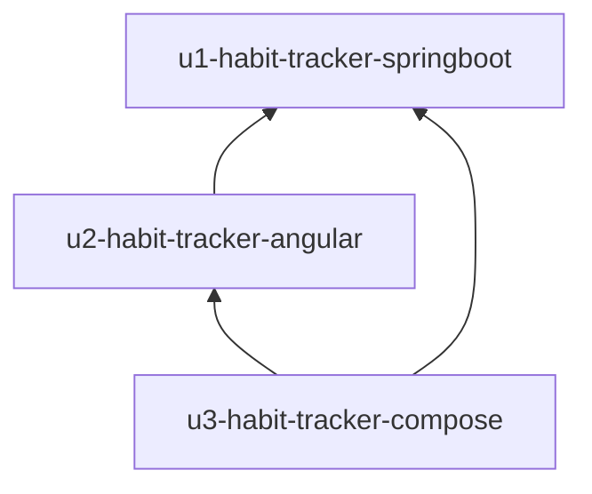

# Unit dependency graph — intent `260914-full-repo-scan`

**Topology only.** This artifact states which units depend on which others. It does **not** recommend Bolt order, critical path, or value/risk sequencing (Stage 2.9 Delivery Planning).

## Dependency DAG (prose)



- **U2 → U1:** SPA calls REST APIs and JWT auth implemented by the backend (`depends_on` encodes client/server build order).
- **U3 → U1, U3 → U2:** Packaging consumes built backend and frontend images (or build contexts); no reverse edges.

The graph is **acyclic**. U1 has no unit dependencies.

## Integration points

| From | To | Mechanism | Data / contract |
|------|-----|-----------|-----------------|
| U2 | U1 | Sync HTTPS REST | `/api/auth/login`, `/api/me`, `/api/habit*`, `/api/habit-track*`, `/api/statistics/*`, `/api/habit-icons`; `Authorization: Bearer <JWT>` |
| U3 | U1 | Container image / build artifact | Backend service definition in compose |
| U3 | U2 | Container image / static asset | Frontend/nginx service in compose |

**Excluded by plan (Q9-A):** No event bus; no shared code library unit. PostgreSQL is external to all units.

**JWT:** Issued by U1 login; U2 stores token and attaches header on API calls; 401 clears session (US1.11).

## Parallel development opportunities

Per Q6-C, this stage lists **edges only**. Multiple valid topological orderings exist in theory (e.g. U1 before U2 before U3 is one linearization). Delivery Planning may discuss parallel work **after** contract baseline; that narrative is intentionally omitted here.

## Machine-readable DAG

```yaml
units:
  - name: habit-tracker-springboot
    kind: service
    depends_on: []
  - name: habit-tracker-angular
    kind: ui
    depends_on:
      - habit-tracker-springboot
  - name: habit-tracker-compose
    kind: packaging
    depends_on:
      - habit-tracker-springboot
      - habit-tracker-angular
```

Unit names match repository slugs for Bolt/worktree correlation in follow-up intents. Construction directory names remain `u1-habit-tracker-springboot`, `u2-habit-tracker-angular`, `u3-habit-tracker-compose` (see `unit-of-work.md`).

## Validation notes

- No self-dependencies.
- No cycles.
- Packaging depends on both application units; SPA depends on backend only.
