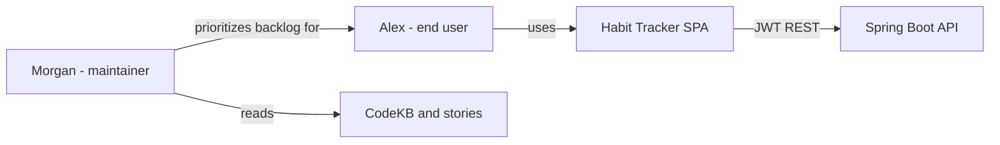

# Personas — intent `260914-full-repo-scan`

## Sources

- Requirements: `inception/requirements-analysis/requirements.md` [memory]
- CodeKB: `codekb/habit-tracker-angular/business-overview.md`, `codekb/habit-tracker-springboot/business-overview.md` [memory]
- Planning Q&A: `user-stories-questions.md` (Q1–Q7, confirmed)

## Persona ranking

| Rank | Persona | Primary stories |
|------|---------|-----------------|
| 1 | Alex — Daily habit tracker | As-built product journeys (auth, track, habits, statistics, settings) |
| 2 | Morgan — Product owner / maintainer | Backlog prioritization, traceability, planning-only intent boundary |

---

## Alex — Daily habit tracker

**Role:** Authenticated end user of the Habit Tracker SPA (production Compose stack or local dev).

**Goals**

- Sign in once and return daily without re-entering credentials until JWT expires
- See which habits are due or done for **today** (server-defined in user timezone)
- Check in or undo check-ins for a chosen calendar day
- Maintain habit definitions (name, icon, schedule metadata exposed by API)
- Review completion over a date range (default: month start through today)
- Keep timezone aligned with real life so “today” matches local midnight boundaries

**Pain points (as-built)**

- Expired JWT forces re-login; no refresh flow
- Track/login mutations may fail silently (unlike Settings timezone save)
- Date picker on Track may allow dates the API rejects (no client min/max aligned to domain window)

**Context**

- Uses desktop top nav or mobile bottom icons after login
- Trusts backend as system of record for streaks, windows, and lifecycle rules

---

## Morgan — Product owner / maintainer

**Role:** Team member planning follow-up intents on `habit-tracker-springboot` and `habit-tracker-angular`; consumes CodeKB and inception artifacts.

**Goals**

- Know what the product **does today** vs what `docs/domain.md` describes as ideal
- Prioritize backlog themes (lifecycle, check-in window, streaks, statistics, UX errors, tests) without treating them as committed work for the scan intent
- Ensure this intent produces planning artifacts only — no application-repo merges attributed to `260914-full-repo-scan`

**Pain points**

- Domain doc vs code gaps are easy to misread as mandatory scope for the scan intent
- Multi-repo `:latest` alignment is manual

**Context**

- Uses AI-DLC workspace and affirmed `team-practices.md` for delivery rules
- Opens a **new intent** when ready to ship code changes

---

## Relationships

Text fallback: Alex uses the SPA backed by the API; Morgan prioritizes backlog and reads CodeKB/stories for future work.
